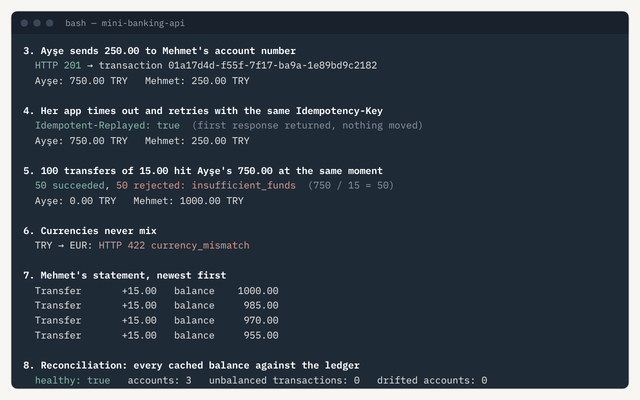
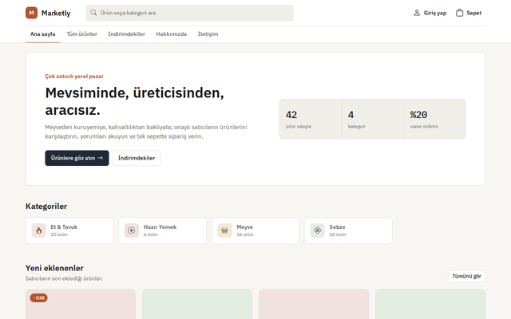
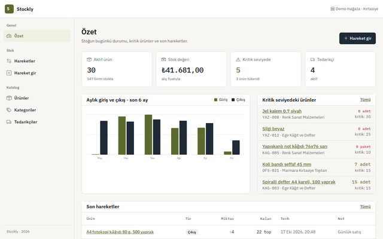
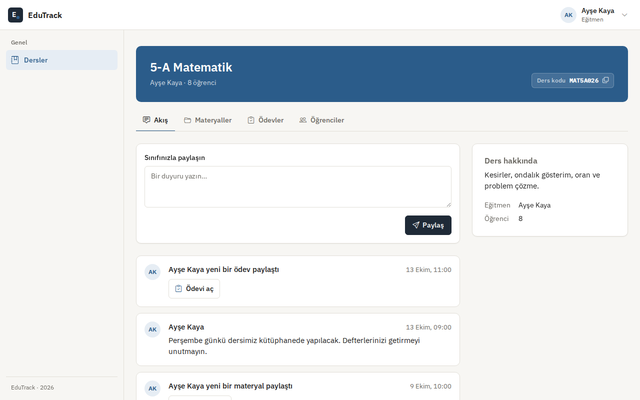
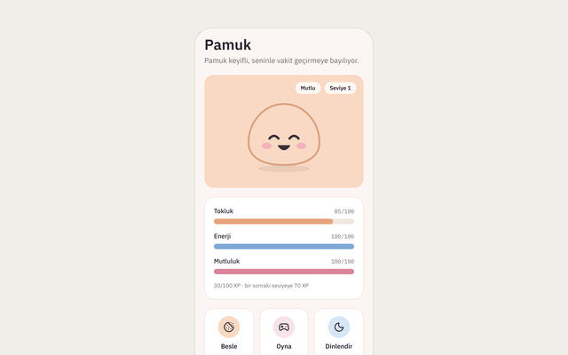
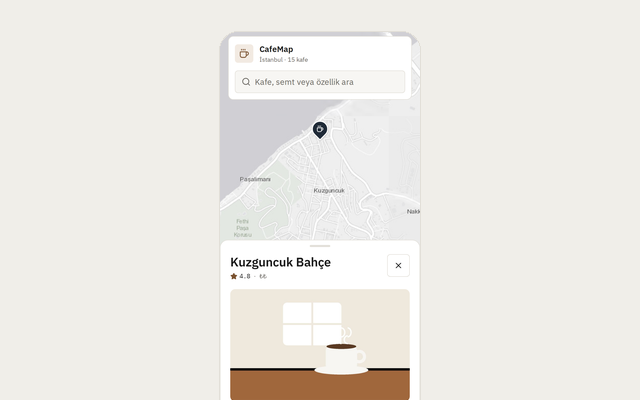

<h1>Berat Oğuzhan Turğut</h1>

<b>Software Developer</b> · C# and .NET · React Native and Expo · Samsun, Türkiye

  
  
  
  

I build web applications and APIs with ASP.NET Core and mobile apps with React Native and Expo. I care about the parts that make software dependable: clear structure, automated tests, CI on every pull request and documentation someone else can follow.

**How I work**

- **Tested:** every project has unit tests and an end-to-end flow in a real browser, run by GitHub Actions on each pull request.
- **Readable history:** small, conventional commits, with each feature delivered through its own pull request.
- **Documented:** a README in English and Turkish, with screenshots, a walkthrough and set-up steps.
- **Careful with the details:** accessible, consistent interfaces; the portfolio scores 100 on Lighthouse.

---

### Featured projects

<table>
  <tr>
    <td width="50%" valign="top">
      
      <h4><a href="https://github.com/Beratoguzhan620/mini-banking-api">Mini Banking API</a></h4>
      
Banking API on a double-entry ledger: idempotent requests, balances that stay correct under concurrent transfers, an append-only audit trail and reconciliation.

      
ASP.NET Core · EF Core · PostgreSQL · Testcontainers · Docker

      
<a href="https://github.com/Beratoguzhan620/mini-banking-api">Code</a> · <a href="https://github.com/Beratoguzhan620/mini-banking-api/blob/main/docs/screenshots/demo.gif">Walkthrough</a>

    </td>
    <td width="50%" valign="top">
      
      <h4><a href="https://github.com/Beratoguzhan620/marketly">Marketly</a></h4>
      
Multi-seller marketplace for local producers: storefront with cart and coupons, order tracking, a seller area, an admin panel and a small File API.

      
ASP.NET Core MVC · Web API · EF Core · SQL Server · Docker

      
<a href="https://github.com/Beratoguzhan620/marketly">Code</a> · <a href="https://github.com/Beratoguzhan620/marketly/blob/main/docs/screenshots/demo.gif">Walkthrough</a>

    </td>
  </tr>
  <tr>
    <td width="50%" valign="top">
      
      <h4><a href="https://github.com/Beratoguzhan620/stockly">Stockly</a></h4>
      
Stock management for a small shop: barcoded products, goods in and out, stock counts, low-stock alerts and Excel/CSV export.

      
ASP.NET Core MVC · EF Core · SQL Server · xUnit · Docker

      
<a href="https://github.com/Beratoguzhan620/stockly">Code</a> · <a href="https://github.com/Beratoguzhan620/stockly/blob/main/docs/screenshots/demo.gif">Walkthrough</a>

    </td>
    <td width="50%" valign="top">
      
      <h4><a href="https://github.com/Beratoguzhan620/EduTrack">EduTrack</a></h4>
      
Classroom app for teachers and students: courses joined with a code, materials, graded assignments and a roster that shows who is behind.

      
ASP.NET Core MVC · EF Core · FluentValidation · SQL Server

      
<a href="https://github.com/Beratoguzhan620/EduTrack">Code</a> · <a href="https://github.com/Beratoguzhan620/EduTrack/blob/main/docs/screenshots/demo.gif">Walkthrough</a>

    </td>
  </tr>
  <tr>
    <td width="50%" valign="top">
      
      <h4><a href="https://github.com/Beratoguzhan620/kawaii-friend">Kawaii Friend</a></h4>
      
A virtual friend to look after: needs that change over time, Firebase sign-in, Firestore with tested security rules, and reminders.

      
Expo · TypeScript · Firebase · Firestore rules · NativeWind

      
<a href="https://beratoguzhan620.github.io/kawaii-friend/"><b>Live demo</b></a> · <a href="https://github.com/Beratoguzhan620/kawaii-friend">Code</a>

    </td>
    <td width="50%" valign="top">
      
      <h4><a href="https://github.com/Beratoguzhan620/cafe-map">CafeMap</a></h4>
      
Istanbul cafes on a map: a bottom sheet for each pin, cards synced with the map and search that handles Turkish letters.

      
Expo · expo-maps · Bottom Sheet · Leaflet · TypeScript

      
<a href="https://beratoguzhan620.github.io/cafe-map/"><b>Live demo</b></a> · <a href="https://github.com/Beratoguzhan620/cafe-map">Code</a>

    </td>
  </tr>
</table>

**More projects:**
[Background Jobs](https://github.com/Beratoguzhan620/background-jobs) (Hangfire workers, retries and a dashboard for admins) ·
[CineList](https://beratoguzhan620.github.io/cinelist/) (film archive, Expo) ·
[Inkwell](https://github.com/Beratoguzhan620/inkwell) (multi-author blog) ·
[EventTracker](https://github.com/Beratoguzhan620/event-tracker) (events with a waiting list) ·
[Rollcall](https://github.com/Beratoguzhan620/rollcall) (attendance and grades) ·
[Bugün Ne Yapalım?](https://beratoguzhan620.github.io/bugun-ne-yapalim/) (activity ideas) ·
[Student CLI](https://github.com/Beratoguzhan620/student-cli) (console app) ·
[Portfolio](https://github.com/Beratoguzhan620/portfolio) (this portfolio and a CV builder)

---

### Tech stack

**Backend** 

**Mobile and web** 

**Testing and delivery** 

---

<b>Türkçe</b>

 

**Yazılım geliştiriciyim.** ASP.NET Core ile web uygulamaları ve API'ler, React Native ve Expo ile mobil uygulamalar geliştiriyorum. Yazılımı güvenilir kılan kısımlara önem veriyorum: anlaşılır bir yapı, otomatik testler, her pull request'te çalışan CI ve başkasının da takip edebileceği belgeler.

- **Testli:** her projede birim testleri ve gerçek tarayıcıda çalışan uçtan uca bir akış var; GitHub Actions bunları her pull request'te çalıştırıyor.
- **Okunur geçmiş:** küçük, anlamlı commit'ler; her özellik kendi pull request'iyle geliyor.
- **Belgelenmiş:** İngilizce ve Türkçe README, ekran görüntüleri, tanıtım kaydı ve kurulum adımları.
- **Ayrıntıya özen:** erişilebilir ve tutarlı arayüzler; portföy sitesi Lighthouse'ta 100 alıyor.

Projelerin tamamı, canlı demolar ve tarayıcıda çalışan CV oluşturucu portföyümde: [beratoguzhan620.github.io/portfolio](https://beratoguzhan620.github.io/portfolio/). Sayfanın sağ üstündeki düğmeyle Türkçeye geçebilirsin.

İletişim: [beratoguzhan620@gmail.com](mailto:beratoguzhan620@gmail.com) · [LinkedIn](https://www.linkedin.com/in/berat-oguzhan-turgut)

