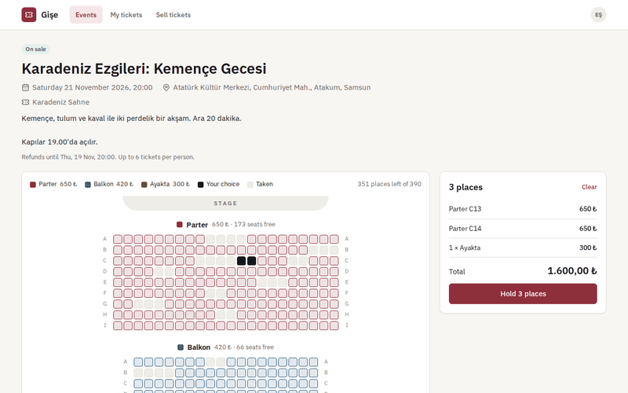
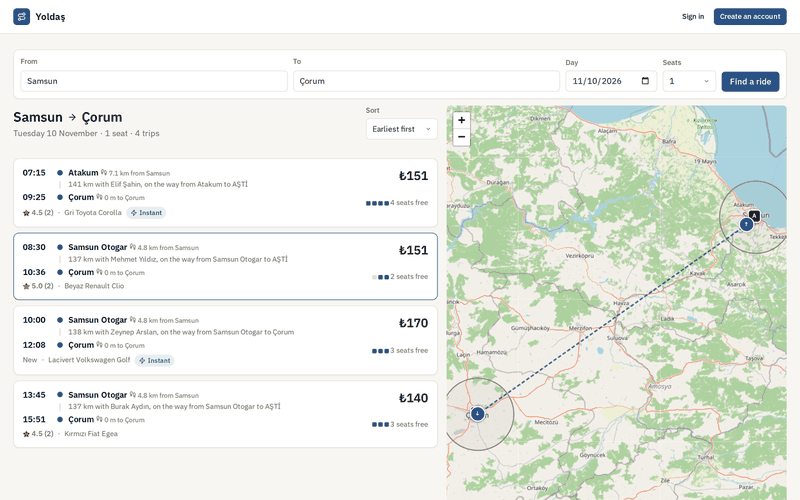
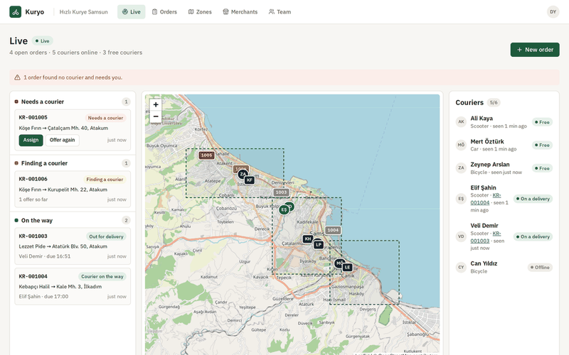
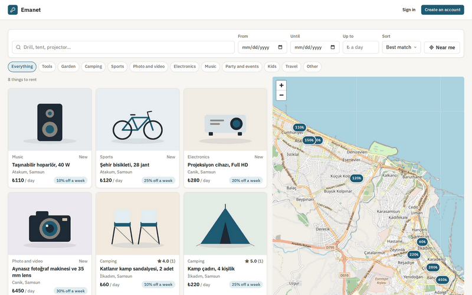
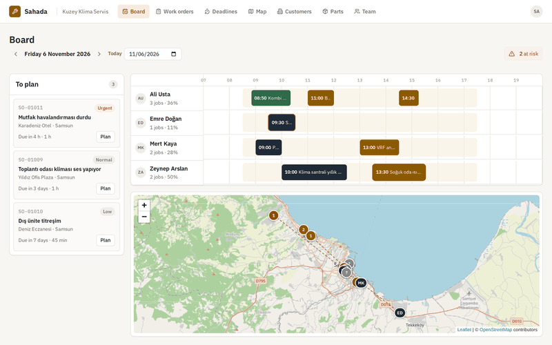
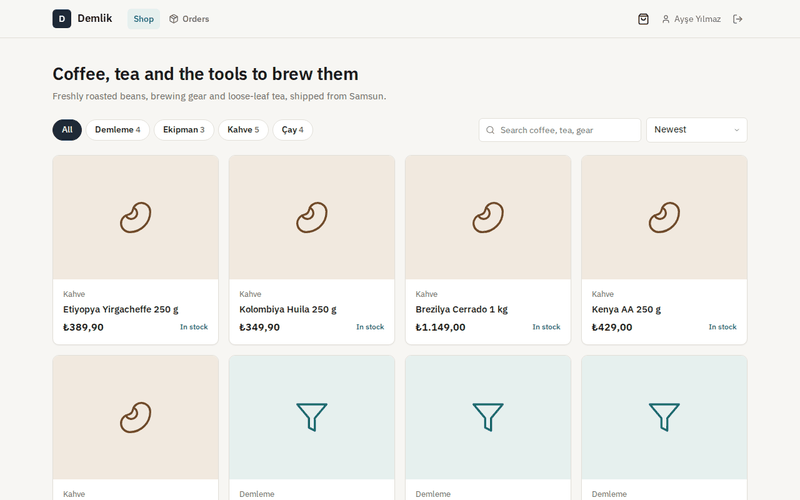

<h1>Berat Oğuzhan Turğut</h1>

<b>Backend Developer</b> · C# and .NET · PostgreSQL · Samsun, Türkiye · looking for a junior .NET / backend role

  
  
  
  

I build backends with ASP.NET Core and PostgreSQL, and the web apps in front of them with React and TypeScript. My recent projects each take one problem real systems get wrong and solve it so it holds under load: selling the same seat twice, money moving twice, a message lost between the database and the queue, two people booking the same day, work done offline on a phone.

**What the 13 recent projects have in common**

- **Correct under concurrency:** the database decides the races (row locks, exclusion constraints, triggers, idempotency keys), and a test proves it, for example 20 people taking the last seat at the same moment and exactly one getting it.
- **Tested against the real thing:** 1,470 automated tests in total, with integration tests running the real API against PostgreSQL, RabbitMQ or Redis in Testcontainers, and end-to-end runs against the whole stack in CI.
- **Measured:** a load test for each product, with the numbers and what they mean in the README.
- **Runs with one command:** `docker compose up` starts the database, the API and the web app.
- **Documented:** a README in English and Turkish with screenshots, a walkthrough GIF, architecture diagrams and the design decisions behind it.

---

### Products

<table>
  <tr>
    <td width="50%" valign="top">
      
      <h4><a href="https://github.com/Beratoguzhan620/gise">Gişe</a></h4>
      
Event ticketing: a seat map that never sells a seat twice, a fair waiting room for the rush and signed QR tickets checked offline at the gate. <b>1,000 buyers at once: 330 seats held, none twice.</b>

      
ASP.NET Core · PostgreSQL · ECDSA · React · Docker

      
<a href="https://github.com/Beratoguzhan620/gise">Code</a> · <a href="https://github.com/Beratoguzhan620/gise/blob/main/docs/screenshots/demo.gif">Walkthrough</a>

    </td>
    <td width="50%" valign="top">
      
      <h4><a href="https://github.com/Beratoguzhan620/yoldas">Yoldaş</a></h4>
      
Ride sharing along the driver's route: search with PostGIS, a fair price by distance, seats counted per part of the route by a database trigger, the car followed live. <b>400 bookings in 2 s, no part of any route over full.</b>

      
ASP.NET Core · PostGIS · SignalR · React

      
<a href="https://github.com/Beratoguzhan620/yoldas">Code</a> · <a href="https://github.com/Beratoguzhan620/yoldas/blob/main/docs/screenshots/walkthrough.gif">Walkthrough</a>

    </td>
  </tr>
  <tr>
    <td width="50%" valign="top">
      
      <h4><a href="https://github.com/Beratoguzhan620/kuryo">Kuryo</a></h4>
      
Courier dispatch: timed offers to the nearest free courier, a live map over SignalR and Redis, a courier PWA and a tracking link for the customer. <b>314 requests a second with no errors; order to first offer p95 35 ms.</b>

      
ASP.NET Core · PostGIS · SignalR · Redis · React

      
<a href="https://github.com/Beratoguzhan620/kuryo">Code</a> · <a href="https://github.com/Beratoguzhan620/kuryo/blob/main/docs/screenshots/walkthrough.gif">Walkthrough</a>

    </td>
    <td width="50%" valign="top">
      
      <h4><a href="https://github.com/Beratoguzhan620/emanet">Emanet</a></h4>
      
Peer-to-peer rentals: a calendar the database will not let anyone double-book, card holds, a double-entry ledger, handovers with codes and damage claims. <b>300 requests for the same days: none booked twice, ledger balanced.</b>

      
ASP.NET Core · PostGIS · MinIO · React

      
<a href="https://github.com/Beratoguzhan620/emanet">Code</a> · <a href="https://github.com/Beratoguzhan620/emanet/blob/main/docs/screenshots/walkthrough.gif">Walkthrough</a>

    </td>
  </tr>
  <tr>
    <td width="50%" valign="top">
      
      <h4><a href="https://github.com/Beratoguzhan620/sahada">Sahada</a></h4>
      
Field service: a day board that suggests the right technician, an offline-first technician app that syncs an operation log, signed PDF service reports. <b>40 phones syncing at once; 400 resent operations, none applied twice.</b>

      
ASP.NET Core · PostgreSQL · MinIO · React · Docker

      
<a href="https://github.com/Beratoguzhan620/sahada">Code</a> · <a href="https://github.com/Beratoguzhan620/sahada/blob/main/docs/screenshots/walkthrough.gif">Walkthrough</a>

    </td>
    <td width="50%" valign="top">
      
      <h4><a href="https://github.com/Beratoguzhan620/microservices-shop">Microservices Shop</a></h4>
      
Six .NET services behind a YARP gateway, with an order saga over RabbitMQ that reserves stock, charges and compensates. <b>60 customers, the last 10 units: exactly 10 sold, the other 50 never charged.</b>

      
ASP.NET Core · RabbitMQ · MassTransit · YARP · React

      
<a href="https://github.com/Beratoguzhan620/microservices-shop">Code</a> · <a href="https://github.com/Beratoguzhan620/microservices-shop/blob/main/docs/screenshots/demo.gif">Walkthrough</a>

    </td>
  </tr>
</table>

### Backend services

| Project | What it does | Measured |
|---|---|---|
| [Mini Banking API](https://github.com/Beratoguzhan620/mini-banking-api) | A double-entry ledger with idempotent, concurrency-safe transfers | 100 transfers at once from one account: never below zero, never moved twice |
| [Background Jobs](https://github.com/Beratoguzhan620/background-jobs) | Scheduled, recurring and retryable jobs with Hangfire on PostgreSQL | a run handed to two workers at once is done once |
| [Notification Service](https://github.com/Beratoguzhan620/notification-service) | Email and in-app delivery over RabbitMQ with an outbox, retries, dead-letter replay and tracing | 122 tests against PostgreSQL, RabbitMQ and Mailpit in containers |
| [Log Analytics](https://github.com/Beratoguzhan620/log-analytics-api) | Log ingestion, search, alerts and a dashboard on partitioned PostgreSQL | 30,294 events a second accepted; 500,000 stored in 22.5 s |
| [Realtime Chat](https://github.com/Beratoguzhan620/realtime-chat) | SignalR chat with read receipts and presence, two instances on a Redis backplane | 2,000 open WebSockets; 215,802 of 215,802 messages delivered |
| [Multi-Tenant SaaS](https://github.com/Beratoguzhan620/multi-tenant-saas) | A help desk many companies share, isolated by PostgreSQL row-level security | 2,000 tickets under load; every company saw only its own |
| [Knowledge Base](https://github.com/Beratoguzhan620/knowledge-base-api) | Answers from a team's own documents with citations: pgvector hybrid search, Ollama, streamed answers | hit@3 97%; 32 of 32 answers cite the right passage |

---

### Earlier projects

[Marketly](https://github.com/Beratoguzhan620/marketly) (multi-seller marketplace, ASP.NET Core MVC) ·
[Stockly](https://github.com/Beratoguzhan620/stockly) (stock management for a small shop) ·
[EduTrack](https://github.com/Beratoguzhan620/EduTrack) (classroom app) ·
[Inkwell](https://github.com/Beratoguzhan620/inkwell) (multi-author blog) ·
[EventTracker](https://github.com/Beratoguzhan620/event-tracker) (events with a waiting list) ·
[Rollcall](https://github.com/Beratoguzhan620/rollcall) (attendance and grades) ·
[Kawaii Friend](https://beratoguzhan620.github.io/kawaii-friend/) (Expo, Firebase) ·
[CafeMap](https://beratoguzhan620.github.io/cafe-map/) (Expo, maps) ·
[CineList](https://beratoguzhan620.github.io/cinelist/) (Expo, Redux Toolkit) ·
[Bugün Ne Yapalım?](https://beratoguzhan620.github.io/bugun-ne-yapalim/) (Expo) ·
[Student CLI](https://github.com/Beratoguzhan620/student-cli) (console app) ·
[Portfolio](https://github.com/Beratoguzhan620/portfolio) (Astro portfolio and a CV builder)

---

### Tech stack

**Backend** 

**Mobile and web** 

**Testing and delivery** 

---

<b>Türkçe</b>

 

**Backend geliştiriciyim.** ASP.NET Core ve PostgreSQL ile backend, React ve TypeScript ile önündeki web uygulamalarını geliştiriyorum. Junior .NET / backend pozisyonu arıyorum. Son projelerimin her biri, gerçek sistemlerin sık yanlış yaptığı bir problemi ele alıp yük altında da doğru kalacak şekilde çözüyor: aynı koltuğun iki kez satılması, paranın iki kez taşınması, veritabanı ile kuyruk arasında kaybolan mesaj, aynı günün iki kişiye kiralanması, telefonda çevrimdışı yapılan işin senkronu.

- **Eşzamanlılıkta doğru:** yarışları veritabanı belirliyor (satır kilitleri, exclusion constraint'ler, tetikleyiciler, idempotency anahtarları) ve bunu bir test kanıtlıyor; örneğin son koltuğu aynı anda alan 20 kişiden tam biri alıyor.
- **Gerçeğine karşı test:** toplam 1.470 otomatik test; entegrasyon testleri gerçek API'yi Testcontainers'taki PostgreSQL, RabbitMQ ya da Redis'e karşı çalıştırıyor, CI'da tüm ortam uçtan uca deneniyor.
- **Ölçülmüş:** her üründe bir yük testi; sonuçlar ve ne anlama geldikleri README'de.
- **Tek komutla çalışır:** `docker compose up` veritabanını, API'yi ve web uygulamasını başlatıyor.
- **Belgelenmiş:** İngilizce ve Türkçe README, ekran görüntüleri, tanıtım GIF'i, mimari diyagramlar ve tasarım kararları.

Projelerin tamamı, canlı demolar ve tarayıcıda çalışan CV oluşturucu portföyümde: [beratoguzhan620.github.io/portfolio](https://beratoguzhan620.github.io/portfolio/). Sayfanın sağ üstündeki düğmeyle Türkçeye geçebilirsin.

İletişim: [beratoguzhan620@gmail.com](mailto:beratoguzhan620@gmail.com) · [LinkedIn](https://www.linkedin.com/in/berat-oguzhan-turgut)

